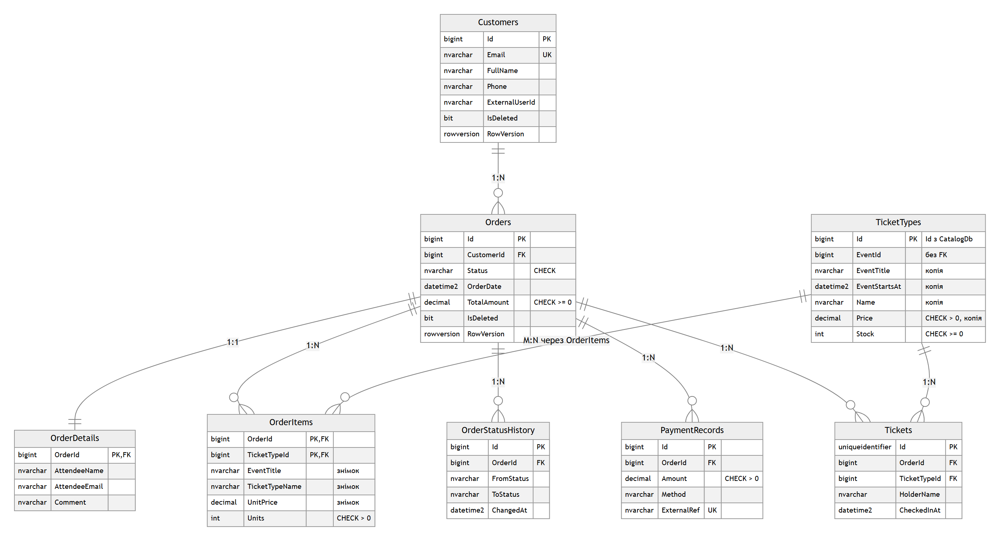
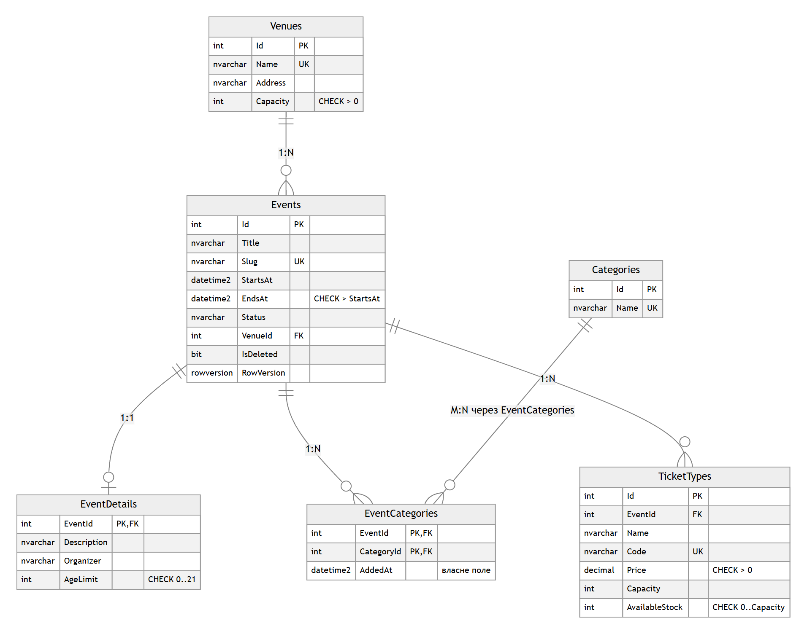

# CampusTix — мікросервісна платформа квитків на кампусні події ЧНУ

Студент: Луханін Богдан Сергійович, група 344Б.

**Домен.** CampusTix продає квитки на події університету (концерти, хакатони, лекції, спорт).
Організатори публікують події з типами квитків (Standard / VIP / Student), студенти оформлюють
замовлення й залишають відгуки.

| Контекст | Сервіс | БД | Технологія | Лаба |
|---|---|---|---|---|
| Замовлення | `Services/Orders` | OrdersDb (SQL Server) | ADO.NET + Dapper | 02 |
| Каталог подій | `Services/Catalog` | CatalogDb (SQL Server) | EF Core Code First | 03 |
| Відгуки | `Services/Reviews` | ReviewsDb (MongoDB) | Clean Architecture + CQRS | 04 |

Усі проєкти — в одному рішенні `Platform.slnx`.

---

## Бази даних (Лаб. 01)

CampusTix продає квитки на кампусні події ЧНУ. Організатори публікують події, студенти купують квитки
й залишають відгуки. Система замінює гугл-форми та продаж на вході єдиним сервісом із контролем місць.

Скрипти: `db/p1` (OrdersDb), `db/p2` (CatalogDb), `db/p3` (ReviewsDb, MongoDB). Агрегати, процедури й вибір ключів описано в [docs/database.md](docs/database.md).

### Контексти

| # | Контекст | БД | Технологія | Сутності |
|---|---|---|---|---|
| 1 | Замовлення | `OrdersDb` (SQL Server) | ADO.NET + Dapper | Customer, Order, OrderDetails, OrderItem, TicketType (копія), OrderStatusHistory, PaymentRecord, Ticket, ProcessedEvent |
| 2 | Каталог | `CatalogDb` (SQL Server) | EF Core Code First | Event, EventDetail, Venue, Category, EventCategory, TicketType |
| 3 | Відгуки | `ReviewsDb` (MongoDB) | Clean Architecture + CQRS | reviews, discussions, messages, eventRatings |

Сутність належить одному контексту. Між базами є лише логічні посилання за Id, жодного `FOREIGN KEY`.

### Політика дублювання

| Поле | Де зберігається | Власник | Політика узгодженості |
|---|---|---|---|
| `OrderItems.EventTitle`, `TicketTypeName`, `UnitPrice` | OrdersDb | Event, TicketType (CatalogDb) | знімок на момент оформлення, не оновлюється ніколи |
| `TicketTypes.Name`, `Price`, `EventTitle`, `EventStartsAt` | OrdersDb (копія) | Event, TicketType (CatalogDb) | оновлюється подіями з Каталогу (Лаб. 08) |
| `TicketTypes.Stock` | OrdersDb | Замовлення | змінює лише сервіс Замовлень; початкове значення дорівнює `Capacity` |
| `reviews.eventTitle`, `discussions.eventTitle` | ReviewsDb | Event (CatalogDb) | оновлюється подією `event.renamed` (Лаб. 08) |
| `reviews.author.displayName` | ReviewsDb | користувач (Auth, Лаб. 09) | знімок на момент написання |

### ERD

**OrdersDb** ([джерело](docs/erd/orders.mmd))



**CatalogDb** ([джерело](docs/erd/catalog.mmd))



### Розгортання з нуля

Потрібен Docker Desktop. Команди виконуються з кореня репозиторію в Git Bash.

#### SQL Server

```bash
export MSSQL_SA_PASSWORD='Your_strong_Pass1'
docker run -d --name campustix-sql -e ACCEPT_EULA=Y -e MSSQL_SA_PASSWORD="$MSSQL_SA_PASSWORD" -p 11433:1433 mcr.microsoft.com/mssql/server:2022-latest
sql() { MSYS_NO_PATHCONV=1 docker exec -e SQLCMDPASSWORD="$MSSQL_SA_PASSWORD" campustix-sql /opt/mssql-tools18/bin/sqlcmd -C -S localhost -U sa -f 65001 -b "$@"; }
docker cp db campustix-sql:/tmp/db

# 1) створити бази
sql -Q "IF DB_ID('OrdersDb') IS NULL CREATE DATABASE OrdersDb; IF DB_ID('CatalogDb') IS NULL CREATE DATABASE CatalogDb;"

# 2) OrdersDb: схема, процедури, дані, перевірка
sql -d OrdersDb -i /tmp/db/p1/schema.sql
sql -d OrdersDb -i /tmp/db/p1/procedures.sql
sql -d OrdersDb -i /tmp/db/p1/seed.sql
sql -d OrdersDb -i /tmp/db/p1/verify.sql

# 3) CatalogDb: схема, дані, перевірка
sql -d CatalogDb -i /tmp/db/p2/schema.sql
sql -d CatalogDb -i /tmp/db/p2/seed.sql
sql -d CatalogDb -i /tmp/db/p2/verify.sql
```

Окремий логін застосунку з доступом лише до своєї БД створює [db/p1/security.sql](db/p1/security.sql).

#### MongoDB

```bash
docker run -d --name campustix-mongo -p 27017:27017 mongo:8.0
docker cp db/p3 campustix-mongo:/tmp/p3
MSYS_NO_PATHCONV=1 docker exec campustix-mongo mongosh --quiet ReviewsDb /tmp/p3/collections.js
MSYS_NO_PATHCONV=1 docker exec campustix-mongo mongosh --quiet ReviewsDb /tmp/p3/seed.js
MSYS_NO_PATHCONV=1 docker exec campustix-mongo mongosh --quiet ReviewsDb /tmp/p3/queries.js
```

Усі скрипти ідемпотентні: повторний запуск не створює дублікатів.

---

## Catalog (Лаб. 03) — EF Core

```
Services/Catalog/
├── Catalog.Domain/   сутності (Event, TicketType, Venue, Category, EventCategory, EventDetail), доменні винятки
├── Catalog.Dal/      CatalogDbContext, Configurations/ (IEntityTypeConfiguration<T>), Migrations/,
│                     Repositories/ (Generic + Eager/Explicit/M:N), UnitOfWork, Seeding/DbInitializer
├── Catalog.Bll/      Services/, Dtos/, Mapping/ (AutoMapper), Validation/ (FluentValidation), Specifications/
└── Catalog.Api/      Controllers/, Middleware/ (ProblemDetails, CorrelationId), Program.cs, appsettings.json, Dockerfile
```

Посилання між шарами: `Api → Bll → Dal → Domain`. Контролери не бачать `DbContext`.

### Схема CatalogDb

| Таблиця | Ключові обмеження | Зв'язок |
|---|---|---|
| Venues | `Name` UNIQUE, CHECK `Capacity > 0`, seed `HasData` | 1:N → Events |
| Events | `Slug` UNIQUE, CHECK `EndsAt > StartsAt`, `RowVersion`, аудит, soft delete | |
| EventDetails | PK = FK `EventId`, CHECK `AgeLimit BETWEEN 0 AND 21` | **1:1** з Events |
| Categories | `Name` UNIQUE, seed `HasData` (6 категорій) | |
| EventCategories | PK (`EventId`, `CategoryId`), **`AddedAt`** DEFAULT `SYSUTCDATETIME()` | **M:N** з власним полем |
| TicketTypes | `Code` UNIQUE (аналог SKU), CHECK `Price > 0`, `decimal(18,2)` | 1:N від Events |

Індекси під запити: `Events(StartsAt)` — список і сортування за датою; `Events(VenueId, StartsAt)` —
події місця; `EventCategories(CategoryId, AddedAt)` — «нещодавно додані в категорію»;
`TicketTypes(EventId, Price)` — квитки події за ціною.

### Запуск

Потрібно: .NET 10 SDK (проєкт сумісний з .NET 9), SQL Server LocalDB або SQL Server у Docker.

```bash
# 1. SQL Server (якщо немає LocalDB)
docker run -d --name catalog-sql -e ACCEPT_EULA=Y -e MSSQL_SA_PASSWORD='Your_strong_Pass1' -p 1433:1433 mcr.microsoft.com/mssql/server:2022-latest
# і перевизначити рядок підключення:
export ConnectionStrings__CatalogDb="Server=localhost,1433;Database=CatalogDb;User Id=sa;Password=Your_strong_Pass1;TrustServerCertificate=True"

# 2. Запуск API: міграції та seed застосовуються автоматично на старті
dotnet run --project Services/Catalog/Catalog.Api --launch-profile http
# Swagger: http://localhost:5105/swagger
```

### Міграції

```bash
dotnet tool install --global dotnet-ef
dotnet ef migrations add InitialCreate --project Services/Catalog/Catalog.Dal --startup-project Services/Catalog/Catalog.Api
dotnet ef database update --project Services/Catalog/Catalog.Dal --startup-project Services/Catalog/Catalog.Api
dotnet ef migrations script --idempotent --project Services/Catalog/Catalog.Dal --startup-project Services/Catalog/Catalog.Api -o Services/Catalog/Catalog.Dal/Migrations/Sql/InitialCreate.sql
```

Згенерований скрипт: `Services/Catalog/Catalog.Dal/Migrations/Sql/InitialCreate.sql`.

**Сідінг** ідемпотентний: довідники (`Venues`, `Categories`) — `HasData` з фіксованими Id у міграції;
події, типи квитків і зв'язки з категоріями — `DbInitializer.SeedAsync` після `MigrateAsync()` з
перевіркою наявності. Вимикається `Seeding:Enabled=false` (у Production вимкнено за замовчуванням).

### Пагінація, фільтрація, сортування

Запит: `page` (з 1), `pageSize` (за замовчуванням 20, максимум 100), фільтри, `sortBy`, `sortDir`.
Відповідь — у тілі (`items, totalCount, page, pageSize, totalPages, hasNext, hasPrevious`) + заголовок
`X-Total-Count`. Усе виконується в SQL (`OFFSET … FETCH`) до `ToListAsync()`.

### Приклади запитів

```bash
# список подій: пошук, категорія, ціна, сортування, сторінка (Specification EventsFilterSpec)
curl "http://localhost:5105/api/events?search=Hack&categoryId=2&minPrice=10&sortBy=price&sortDir=desc&page=1&pageSize=5"
# пагінація типів квитків: totalCount = кількість усіх записів
curl "http://localhost:5105/api/ticket-types?page=2&pageSize=5&sortBy=price&sortDir=desc"
# картка події — Eager Loading (1 SQL-запит)
curl http://localhost:5105/api/events/1
# події категорії — Explicit Loading (2 SQL-запити)
curl http://localhost:5105/api/categories/1/events
# нещодавно додані в категорію — LINQ M:N через EventCategory.AddedAt
curl "http://localhost:5105/api/categories/2/recent-events?days=30"
# найближчі події місця — друга специфікація UpcomingEventsByVenueSpec
curl http://localhost:5105/api/venues/1/events
# створення: 201 + Location
curl -i -H "Content-Type: application/json" -d '{"eventId":1,"name":"Early","code":"CONC26-EARLY","price":99.5,"capacity":10}' http://localhost:5105/api/ticket-types
# той самий код ще раз -> 409
curl -i -H "Content-Type: application/json" -d '{"eventId":1,"name":"Early","code":"CONC26-EARLY","price":99.5,"capacity":10}' http://localhost:5105/api/ticket-types
# порожні поля -> 400 ValidationProblemDetails; неіснуючий Id -> 404
curl -i -H "Content-Type: application/json" -d '{"eventId":1,"name":"","code":"","price":0,"capacity":0}' http://localhost:5105/api/ticket-types
curl -i http://localhost:5105/api/events/999
# списання більше, ніж є -> 409 (DomainException з TicketType.RemoveStock)
curl -i -H "Content-Type: application/json" -d '{"quantity":5000}' http://localhost:5105/api/ticket-types/1/stock/remove
```

### Обробка помилок і логування

`GlobalExceptionHandler` (`IExceptionHandler` + `AddProblemDetails`): `EntityNotFoundException → 404`,
`ValidationException → 400`, `ConflictException`/`DomainException`/`DbUpdateConcurrencyException`/дубль ключа `→ 409`,
решта `→ 500` без деталей поза Development. Кожен виняток логується один раз — в обробнику.

Serilog налаштовано в `appsettings.json` (рівні, sink-и Console + File `logs/catalog-*.log` у JSON).
Властивості: `CorrelationId` (заголовок `X-Correlation-Id`), `UserId`, `RequestPath`, `Service`.
SQL-команди EF Core (`Microsoft.EntityFrameworkCore.Database.Command`) пишуться на рівні Information.
